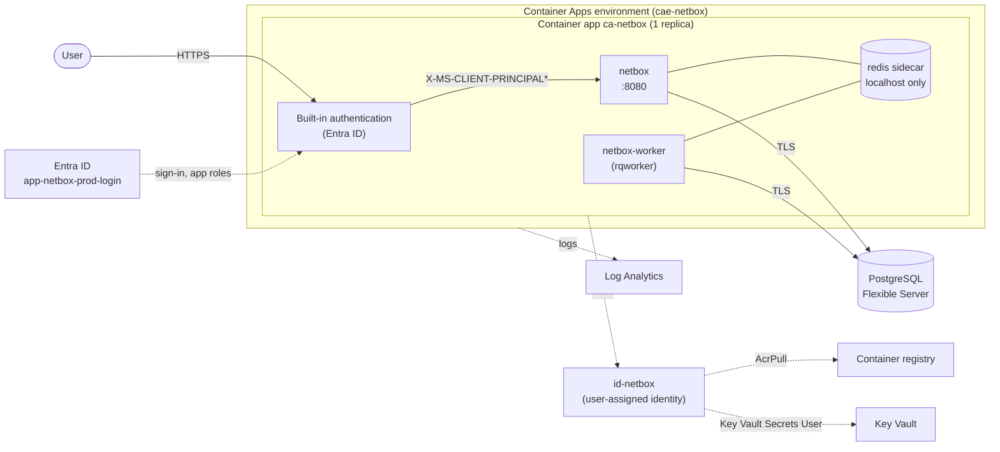

# NetBox on Azure Container Apps

Deploy [NetBox](https://github.com/netbox-community/netbox) (the community
[`netboxcommunity/netbox`](https://github.com/netbox-community/netbox-docker) image) to Azure Container
Apps with Bicep and an Azure DevOps pipeline. Every request is signed in with Entra ID before it reaches
NetBox, and Entra app roles decide who is an administrator and who can only read.

- **No secrets in the repository.** The pipeline generates them into Key Vault, and the app reads them
  at runtime through a managed identity.
- **No NetBox configuration file to maintain.** The upstream image builds its configuration from
  environment variables, which are set in Bicep.
- **Custom domains with free managed certificates** that Container Apps issues and renews.
- **Entra is the source of truth for access.** Users are created on first sign-in, and their NetBox
  groups follow their Entra app roles on every sign-in.
- **Repeatable pipeline.** The image is only rebuilt when its inputs change, a what-if runs before
  every deployment, and runs never overlap.

## Architecture



The diagram shows the default `redisMode = 'sidecar'`. With `'managed'`, the sidecar is replaced by Azure
Managed Redis (see [Redis: sidecar or managed](#redis-sidecar-or-managed)).

| Resource | Purpose |
| --- | --- |
| Container Apps environment `cae-netbox` | Consumption workload profile, logs to `log-netbox` |
| Container app `ca-netbox` | `netbox` (web, port 8080), `netbox-worker` (rqworker) and, in sidecar mode, `redis` (localhost only) |
| Azure Managed Redis `redis-netbox-*` | Only with `redisMode = 'managed'`: job queues and cache, TLS, access key in Key Vault |
| Container Apps authentication | Signs every request in with Entra ID. NetBox trusts the `X-MS-CLIENT-PRINCIPAL-NAME` header, creates users automatically, and maps the user's Entra app roles to NetBox groups (`app/netbox_easyauth.py`) |
| PostgreSQL Flexible Server `psql-netbox-*` | Burstable B1ms, v16, TLS required, `ltree` extension allowed |
| Key Vault `kv-netbox-*` | All secrets, with RBAC and purge protection. The pipeline generates the secrets and the app reads them through `id-netbox` |
| Container registry `crnetbox*` | The NetBox image built from this repo, plus the official Redis image (`redisImage`, pinned) imported from Docker Hub |
| Managed certificates `mc-*` | One per custom domain, issued and renewed by Container Apps |
| Managed identity `id-netbox` | Pulls images and reads secrets. It is user-assigned, so its role assignments can exist before the app's first revision starts |
| Entra app `app-netbox-prod-login` | Sign-in app with the app roles `netbox-admins`, `netbox-editors` and `netbox-readers`, managed by `infra/entra.bicep` |

### How NetBox is configured

The netbox-docker image ships its own `/etc/netbox/config/configuration.py`, which reads every setting
from environment variables. `infra/main.bicep` sets those variables:

- **Non-secret settings**, such as banners and exempt view permissions, are parameters in
  `infra/environments/prod.bicepparam`.
- **Secrets** (database password, `SECRET_KEY`, API token pepper, Redis password, Entra client secret)
  are Container Apps secrets that reference Key Vault.

> [!NOTE]
> Extra files in `/etc/netbox/config/` **cannot** override a setting that the image's
> `configuration.py` already defines, because the first definition wins. Use them only for settings it
> doesn't cover, or for plugins.

### Network

For now, PostgreSQL accepts connections from Azure services and the app ingress is public, with Entra
ID in front of it. For a private setup, see [Improvements](#improvements--roadmap).

## Repository layout

```
Dockerfile                             NetBox image: upstream image + app/netbox_easyauth.py (extend here for plugins)
app/netbox_easyauth.py                 maps Entra app roles from the sign-in header to NetBox groups
infra/foundation.bicep                 registry, Key Vault, identity, Container Apps environment, Log Analytics, role assignments
infra/entra.bicep                      Entra sign-in app and its roles (Microsoft Graph Bicep)
infra/main.bicep                       PostgreSQL, container app, Entra authentication
infra/modules/postgres.bicep           PostgreSQL Flexible Server + database
infra/modules/managed-redis.bicep      Azure Managed Redis + access key in Key Vault (redisMode = 'managed')
infra/environments/*.bicepparam        per-environment parameters
pipelines/azure-pipelines.yml          Foundation -> Build -> What-if -> Deploy
pipelines/variables/prod.yml           service connection, resource group, images, first superuser
scripts/Initialize-PipelineAccess.ps1  one-time: what the pipeline identity may do (run once by an Owner)
scripts/Set-NetboxLoginAccess.ps1      assigns groups to app roles, stores the client secret (run by you)
scripts/Initialize-NetboxSecrets.ps1   generates the secrets into Key Vault (pipeline)
scripts/Deploy-NetboxEntra.ps1         deploys entra.bicep (pipeline)
scripts/Deploy-Netbox.ps1              deploys or what-ifs main.bicep (pipeline)
scripts/Get-NetboxImageTag.ps1         content-hash image tag (pipeline)
```

## Prerequisites

- An Azure subscription with the resource providers `Microsoft.App`, `Microsoft.ContainerRegistry`,
  `Microsoft.DBforPostgreSQL`, `Microsoft.KeyVault`, `Microsoft.OperationalInsights` and
  `Microsoft.ManagedIdentity` registered.
- An Azure DevOps project with an **Azure Resource Manager service connection** (workload identity
  federation recommended). You set up its permissions in step 1 below.
- PowerShell 7 and the Azure CLI, to run the one-time scripts locally.
- For the one-time setup: someone who is **Owner** of the subscription or resource group, and someone
  who is **Privileged Role Administrator** in Entra (to grant the Graph permission). For assigning groups
  later: **Cloud Application Administrator**.

Set your own values in `pipelines/variables/prod.yml` (`serviceConnection`, `resourceGroupName`,
`location`) and the banners in `infra/environments/prod.bicepparam`.

### What the pipeline identity may do

The pipeline creates everything, including role assignments and the Entra sign-in app, but its rights are
kept narrow:

| Permission | Scope | Used for |
| --- | --- | --- |
| Contributor | Resource group | Deploying resources |
| Role Based Access Control Administrator, **with a condition** | Resource group | Assigning only *AcrPull*, *Key Vault Secrets User* and *Key Vault Secrets Officer*, and only to service principals: `id-netbox`, plus the pipeline's own access to the vault. It can't grant Owner, Contributor or any other role, or give anything to users or groups |
| Microsoft Graph `Application.ReadWrite.OwnedBy` | Tenant | Creating and updating the sign-in app. It only covers apps the pipeline owns |

Two things deliberately stay with people, in `scripts/Set-NetboxLoginAccess.ps1`:

- **Who gets which role.** Assigning groups to app roles from the pipeline would need
  `AppRoleAssignment.ReadWrite.All`, which can grant any app role in the tenant, including Graph
  permissions to itself.
- **The client secret.** Microsoft Graph Bicep can't create application passwords.

## First deployment

1. **Set up the pipeline identity (once).** Run this as Owner, for example after PIM elevation, with the
   service connection's client ID. It creates the resource group if needed and assigns the permissions
   above. `-GrantGraphPermission` grants the Graph permission, which needs Privileged Role Administrator
   (or have one run that part). `-IncludeCurrentUser` gives you *Key Vault Secrets Officer* on the
   resource group, which you need in step 3.
   ```powershell
   az login --tenant <tenant-id>
   ./scripts/Initialize-PipelineAccess.ps1 -SubscriptionId <subscription-id> -ResourceGroupName rg-netbox-prod `
       -Location swedencentral -PipelineClientId <service-connection-client-id> -GrantGraphPermission -IncludeCurrentUser
   ```

2. **Create the pipeline** in Azure DevOps from `pipelines/azure-pipelines.yml`, create an environment
   named `netbox-prod`, and run the pipeline. *Foundation* creates the resources, their role assignments,
   the secrets and the sign-in app `app-netbox-prod-login`. *What-if* and *Deploy* finish with a warning
   that the client secret is missing; that's expected on the first run.

3. **Assign the admin group and create the client secret.**
   ```powershell
   ./scripts/Set-NetboxLoginAccess.ps1 -ResourceGroupName rg-netbox-prod -AdminGroupObjectId <admin-group-object-id>
   ```
   This gives the group the admin role and stores a client secret (valid for 1 year) as
   `entra-client-secret` in Key Vault.

4. **Set `initialSuperuserUpn`** in `pipelines/variables/prod.yml` to your Entra sign-in name. The pipeline
   creates a local superuser with exactly this username, so your first Entra sign-in lands on an admin
   account. This user also stays a superuser even if their token has no app roles (break-glass).

5. **Commit and run the pipeline again.** This time NetBox is deployed. You can add approvals and an
   exclusive lock on the `netbox-prod` environment. On the first start, NetBox runs all database
   migrations, which takes a few minutes.

6. **Open the URL** from the deploy output (`https://ca-netbox.<environment-domain>`, or your
   custom domain once you've added one).

## Custom domains

NetBox can be served on your own host names, such as `netbox.contoso.com`. Each one gets a free managed
certificate that Container Apps issues and renews. The default `ca-netbox.<environment-domain>` name
keeps working alongside them.

1. **Create two DNS records** for each host name:

   | Type | Name | Value |
   | --- | --- | --- |
   | `CNAME` | `netbox.contoso.com` | `ca-netbox.<environment-domain>` (the `netboxFqdn` output of the foundation deployment) |
   | `TXT` | `asuid.netbox.contoso.com` | the `customDomainVerificationId` output of the foundation deployment |

   ```powershell
   az deployment group show -g rg-netbox-prod -n netbox-foundation --query "properties.outputs.{cname: netboxFqdn.value, txt: customDomainVerificationId.value}"
   ```

2. **Add the host name** to `customDomains` in `infra/environments/prod.bicepparam`. Use lower case. The
   first entry becomes the URL that NetBox prefers.
   ```bicep
   param customDomains = [ 'netbox.contoso.com' ]
   ```

3. **Commit and run the pipeline.** The Foundation stage adds the host name's sign-in callback to the
   Entra app. A managed certificate can only be issued after the host name has
   been added to the app, so `scripts/Deploy-Netbox.ps1` deploys in two passes. The first pass adds the
   host name unbound and requests the certificate. The script then waits for the certificate to be
   issued (usually a few minutes, at most 20) and runs a second pass that binds it. If issuing fails or
   takes longer, the run fails with the reason; the next run binds the certificate once it's issued.
   Later runs bind it directly. Every host name is also added to
   `ALLOWED_HOSTS` and `CSRF_TRUSTED_ORIGINS`.

Managed certificates validate through the `CNAME`, so this works for subdomains, not for apex domains
(`contoso.com`). Create the DNS records before you add the host name: without them, the deployment
fails when it adds the host name to the app.

**Removing a custom domain.** Remove it from `customDomains` and run the pipeline. That unbinds the host
name, but its managed certificate stays in the Container Apps environment. Delete it yourself, then
remove the DNS records. The next pipeline run removes the redirect URI from the Entra app:

```powershell
az containerapp env certificate list -g rg-netbox-prod -n cae-netbox --managed-certificates-only -o table
az containerapp env certificate delete -g rg-netbox-prod -n cae-netbox --certificate <certificate-name> --yes
```

## Granting access

Entra is the source of truth. Only groups assigned to the enterprise app `app-netbox-prod-login` can
sign in, and the **app role** a group is assigned decides what its members get in NetBox:

| App role | Example group | In NetBox |
| --- | --- | --- |
| `netbox-admins` | Platform owners (a few people) | **Superuser**: everything, including users, groups, permissions, custom fields, scripts and data sources |
| `netbox-editors` | Network / operations team | **View, add, change and delete** in Organization/DCIM, Circuits, Wireless, IPAM, VPN and Virtualization, plus tags, journal entries and image attachments. No administration |
| `netbox-readers` | Developers | **View only**, on the same areas as editors |

Assign roles with the script. A group has one role, so assigning a new one replaces the old:

```powershell
./scripts/Set-NetboxLoginAccess.ps1 -ResourceGroupName rg-netbox-prod -AdminGroupObjectId  <admin-group-object-id>
./scripts/Set-NetboxLoginAccess.ps1 -ResourceGroupName rg-netbox-prod -EditorGroupObjectId <editor-group-object-id>
./scripts/Set-NetboxLoginAccess.ps1 -ResourceGroupName rg-netbox-prod -ReaderGroupObjectId <reader-group-object-id>
```

How it works:

- **On every sign-in**, `app/netbox_easyauth.py` reads the roles from the `X-MS-CLIENT-PRINCIPAL`
  header that Container Apps sets, and NetBox's group sync makes the user's groups match those roles
  exactly. Superuser status follows `netbox-admins`. Any group header sent by the client is ignored.
- **The editor and reader permissions are managed in code.** After each start of the app, the backend
  creates the `netbox-editors` and `netbox-readers` groups and their permissions, and resets them to the
  definition in `ROLE_PERMISSIONS`. The list of apps comes from `NETBOX_ROLE_APPS`. Non-superusers only
  see what they're allowed to view, so editors and readers get a menu with just these areas. To change
  what a role gets, edit `ROLE_PERMISSIONS` in the backend rather than in the NetBox UI.
- **Every change by an editor is recorded** in NetBox's changelog, with the user and the before and after
  values, so mistakes can be traced and reverted by hand.
- **The roles themselves are defined in `infra/entra.bicep`.** To add a role, add it there (the app role)
  and in `ROLE_PERMISSIONS` (what it may do in NetBox), then run the pipeline.
- **Changes take effect at the next sign-in.** Sessions last at most 8 hours (`LOGIN_TIMEOUT`), so a
  role change in Entra applies at the next sign-in. Someone removed from the Entra group is blocked at
  their next Container Apps sign-in.

## Operations

- **The image is only built when it changes.** The NetBox image tag is `<base tag>-<hash>`, where the
  hash covers `Dockerfile`, `app/` and `netboxBaseImage` (`scripts/Get-NetboxImageTag.ps1`). The
  pipeline skips the build when that tag already exists, and Deploy uses the same tag, so a run with no
  image changes doesn't restart NetBox.
- **Upgrading NetBox.** Pin `netboxBaseImage` in `pipelines/variables/prod.yml` to a specific
  netbox-docker tag and bump it deliberately. A new value changes the image tag and triggers a build.
  With `latest`, upstream releases are **not** picked up until something else changes. Migrations run
  automatically on start.
- **Rotating the Entra client secret** (yearly):
  `./scripts/Set-NetboxLoginAccess.ps1 -ResourceGroupName rg-netbox-prod -RotateSecret`, then restart the
  revision.
- **Redis sidecar image** is the official Docker Hub image, pinned in `redisImage` in
  `pipelines/variables/prod.yml`. To upgrade, bump the tag: the pipeline imports the new tag into the
  registry and the next deployment uses it.
- **Uploaded media** (image attachments) is stored in the container and lost on restart. If you use
  attachments, mount an Azure Files share at `/opt/netbox/netbox/media`.
- **API access.** `/api/` is behind Entra sign-in as well. For automation that uses NetBox API tokens,
  you can exclude `/api/*` in the auth config (`globalValidation.excludedPaths`) and rely on NetBox token
  authentication there.

  > [!WARNING]
  > **Not tested yet.** NetBox trusts `X-MS-CLIENT-PRINCIPAL-NAME` as the signed-in user. Container Apps
  > sets that header on authenticated requests, but on excluded paths a client might be able to send its
  > own and sign in as anyone. Before you exclude `/api/*`, test that a request to an excluded path
  > with a forged `X-MS-CLIENT-PRINCIPAL-NAME` header does **not** sign you in. If it does, don't exclude
  > the path.

## Redis: sidecar or managed

NetBox uses Redis for its cache and for the job queues of the background worker (webhooks, event rules,
scripts, data syncs). Set `redisMode` in `infra/environments/prod.bicepparam`:

| | `sidecar` (default) | `managed` |
| --- | --- | --- |
| Runs as | `redis` container next to NetBox, localhost only | Azure Managed Redis (`Balanced_B0` by default) |
| A restart of the app | Clears the cache **and queued jobs** | Keeps everything |
| SLA | None | With high availability (`managedRedisHighAvailability`, default on) |
| Approximate cost | ~$6–20/month in container resources | B0: ~$25/month with HA, ~$12/month without (Sweden Central list price) |
| Connection | Plain text on localhost, generated password | TLS on port 10000, access key stored in Key Vault by Bicep |

Choose `managed` when webhooks and other queued jobs must not be lost on a restart. Things to know:

- **One database.** Azure Managed Redis has a single database, so the queues and the cache share
  database 0. Their keys don't overlap, but don't flush the database by hand: that would also remove
  queued jobs.
- **Eviction.** When memory is full, Redis evicts only keys that have an expiry (`VolatileLRU`): cache
  entries and finished job results. Queues and pending jobs have no expiry, so they're never evicted.
- **Access keys.** NetBox can only authenticate to Redis with a password, so access-key authentication is
  enabled. The key is stored in Key Vault as `managed-redis-access-key`. `scripts/Deploy-Netbox.ps1`
  compares the cache's current key with the stored one and only writes it when it's missing or
  different, so routine runs don't add secret versions. After regenerating the key, run the pipeline and
  restart the revision.
- **Public endpoint.** The cache is reachable from the internet, protected by the key and TLS, like
  PostgreSQL today. Move it to a private endpoint along with the rest (see the roadmap).
- **Switching modes.** Going to `managed` creates the cache and replaces the sidecar in a new revision,
  so anything queued in the sidecar at that moment is lost. Going back to `sidecar` does **not** delete
  the cache; delete `redis-netbox-*` yourself to stop paying for it.
- **Still one replica.** Uploaded media lives in the container, so the app stays at one replica in both
  modes. To scale out with `managed`, first move media to Azure Files.

## Improvements / roadmap

Ideas for taking this from a showcase to a hardened production setup:

- **Private networking:** a VNet-integrated Container Apps environment, PostgreSQL in a delegated
  subnet (or behind a private endpoint), and private endpoints for Key Vault and the registry. This
  removes the *Allow Azure services* firewall rule, which admits traffic from any Azure tenant.
- **Microsoft Entra authentication for PostgreSQL** using `id-netbox`, instead of the generated admin
  password. At a minimum, use a dedicated, non-admin database role for the app.
- **Persistent media** on Azure Files.
- **PR validation:** run `bicep lint` and PSScriptAnalyzer on pull requests.
- **No client secret:** use `id-netbox` as a federated credential for the sign-in app instead of a
  client secret, if Container Apps authentication supports it. That would remove the yearly rotation.

## License

[MIT](LICENSE)
